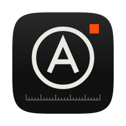

<div align="center">

<a href="https://amazynk.com/stockroom/"></a>

<h1>Stockroom</h1>

<p>
  Installs, updates and removes the amazynk apps on Linux, Windows and macOS.
  <br>
  Free and open source. Per-user installs without admin rights, and updates that can be rolled back.
</p>

<p>
  <a href="https://amazynk.com/stockroom/">Website</a>
  ·
  <a href="#build">Build</a>
  ·
  <a href="#use">Use</a>
  ·
  <a href="#how-it-installs">How it installs</a>
  ·
  <a href="#the-app-list">The app list</a>
  ·
  <a href="PLAN.md">Plan</a>
  ·
  <a href="CONTRIBUTING.md">Contributing</a>
</p>

<p>
  <a href="https://github.com/amazynk/stockroom/actions/workflows/ci.yml"></a>
  <a href="#license"></a>
  <a href="#build"></a>
  <a href="https://amazynk.com/discord/"></a>
</p>

</div>

Stockroom installs, updates and removes the family's apps on Linux, Windows and macOS. It
lists the apps whose source is public: Specular, which it installs from its GitHub releases,
Dozed, which sets itself up and is opened on its own page, and Pagebara, which has no
release yet and is shown as coming. One small binary, per-user installs without admin
rights, one app list on amazynk.com, atomic updates with rollback. Rust, no `unsafe` in our
code. The name, app ID and list address are in
[`crates/suite-identity`](crates/suite-identity/src/lib.rs); the crates keep the working name
`suite-*` from before it was named (2026-11-20). Its page is
[amazynk.com/stockroom](https://amazynk.com/stockroom/).

**There is no release yet.** Nothing is packaged for download: Stockroom is built from this
source (see [Build](#build)).

Status: milestones 1 to 3 of [PLAN.md](PLAN.md) and part of 4. The core, the CLI and the app
window work on Linux and, since 2026-11-19, on a real Mac (Apple Silicon, macOS 27): the
test suite passes there, the window opens through Metal, and Specular's real disk image
installs, updates the list, and is removed again under `--root`. The Windows integration is
written, tested through fakes and cross-checked, not yet run on a real Windows PC. The app
list is live at `https://amazynk.com/stockroom/catalog.json` (its files are in the site
repository's `public/stockroom/`); when it can't be fetched, a copy of Stockroom works from
the list it carries inside (see "The app list").

## Build

```sh
cargo build                      # toolchain is pinned in rust-toolchain.toml
cargo test --workspace
cargo lint                       # clippy, warnings as errors
cargo deny check
cargo clippy --workspace --all-targets --target x86_64-pc-windows-gnu -- -D warnings
                                 # likewise x86_64-pc-windows-msvc, x86_64-apple-darwin, aarch64-apple-darwin
cargo build --profile dist       # what ships: fat LTO, opt-level "s", stripped (sizes in PLAN.md §9)
cargo build --profile dist -p suite-cli --no-default-features   # software rendering only, no wgpu
./fuzz/run.sh 30                 # catalog JSON, tar and zip, 30 s each (cargo-fuzz)
```

What gets handed out, in `dist/` (each takes `--for <app>`, see "Handing it out with an app"):

```sh
packaging/macos/build-app.sh     # Stockroom.app and its zip: universal when both Mac targets are installed;
                                 # ad hoc signed, or STOCKROOM_SIGN_IDENTITY (+ STOCKROOM_NOTARY_PROFILE)
packaging/windows/build.sh       # stockroom.exe, stockroom.com, stockroom-shim.exe and a zip; from a Mac or Linux
                                 # with MinGW (x86_64-pc-windows-gnu), or on Windows with MSVC
packaging/icons/render.sh        # Stockroom's icon in every size, .icns and .ico (needs resvg)
```

On Linux the program is handed out as it is: the first run puts its icon and menu entry in
place (see below).

From a Mac, the Linux check stops at the system libraries (fontconfig, and the C in `ring`);
`-p suite-catalog -p suite-platform -p suite-unpack -p suite-detect` pass there, and the
Windows targets check in full.

`/tmp` noexec? Set `TMPDIR=$PWD/target/tmp`: the tests run the apps they install.

The window's accessibility tests query Slint's element tree, which needs debug info in the
generated code: `SLINT_EMIT_DEBUG_INFO=1 cargo test --workspace` (without it they skip).

## The window

`crates/suite-ui` (logic, view models, tests) and `crates/suite-ui-markup` (the `.slint`
files and translations) are built like the family's other windows: the femtovg renderer on wgpu with a
software fallback (`STOCKROOM_RENDERER=software`), one `Theme` global for light and dark, bundled
gettext catalogs (en, de, es, fr, nl), frame timing under `STOCKROOM_LOG=suite_ui::timing=info`,
and no redraws while idle. The window drives `suite-core` only: its job queue and progress
events, rows, settings and the scheduler. While jobs run it holds a user-initiated activity
on macOS (`suite_platform::UserActivity`), so App Nap doesn't slow an install whose window
is out of sight. A window that is fully covered isn't redrawn until it shows again, which
is Slint's doing and expected: the work goes on behind it.

```sh
cargo run -p suite-ui --example demo                         # fake family data, local server
STOCKROOM_DEMO_SNAPSHOT=out/ cargo run -p suite-ui --example demo  # every screen, both themes, as PNGs
cargo run -p suite-ui --example builtin -- out/              # the real built-in list, as each OS shows it
python3 crates/suite-ui-markup/tools/contrast.py             # WCAG contrast of the theme
python3 crates/suite-ui-markup/tools/extract.py              # refresh the .pot and catalogs
```

Snapshots are drawn by the software renderer into memory (window contents only, no display).

## Use

```sh
stockroom list                       # the apps: installed, available, coming soon, or why not here
stockroom install specular           # newest stable release for this computer
stockroom install specular --channel beta
stockroom update specular            # or: stockroom update --all
stockroom rollback specular          # back to the version kept from before the last update
stockroom remove specular [--purge]  # --purge also deletes its settings and data
stockroom status                     # versions, channels, policies, updates, other installs
stockroom policy specular ask        # updates: auto (default), ask, never
stockroom files pagebara on          # Windows: offer it in "Open with" for its file types (HKCU)
stockroom schedule on                # daily background run: systemd timer, LaunchAgent or schtasks
stockroom update --background        # what the scheduler runs: at most daily, not on metered links
stockroom doctor                     # platform, scheduler, state, catalog and the fallback list
stockroom uninstall                  # take Stockroom itself away (the apps it installed stay)
stockroom                            # the app window (one per user: a second start raises it)
stockroom install specular --ui      # a small install-then-Open window (for the family's apps)
```

### Handing it out with an app

One build serves every app. Started without a command under a name that contains an app's
ID (`specular-setup`, `Specular-Installer (1).exe`, `Install Specular.app`), Stockroom opens
that app's install window instead of the app list. The packaging scripts make these:
`--for specular` writes `Install Specular.app` (and its zip) on a Mac and
`Install Specular.exe` for Windows. The window installs the app and, under
the progress, offers up to three of the other apps that aren't on the computer yet, with a
link to all of them. So each project can ship the same file under its own name.

Started from the user's folders, Stockroom keeps a copy of itself in its data folder
(`<data>/bin/stockroom`) and registers that copy for the daily check and in the apps' uninstall
entries, so both keep working after the download is deleted. So does a Mac app run from a
disk image or from where Gatekeeper translocates a download. On Linux the copy also gets the
`stockroom` command in `~/.local/bin` and an application-menu entry with Stockroom's icon (the
window's Wayland app ID and X11 class are `com.amazynk.Stockroom`, the entry's name, so docks
show that icon); on Windows a Start-menu shortcut, and the launcher shim and `stockroom.com`
beside it, which a release `stockroom.exe` carries inside itself so a single downloaded file is
enough. A newer download replaces the copy, an older one doesn't, and a Stockroom outside the
user's folders (a package, `/Applications`) is left where it is. `stockroom uninstall` removes
the copy, its menu entry, the daily check, the downloads and the saved list.

For development, everything can live in a folder, against any catalog:

```sh
stockroom --root /tmp/s --catalog ./out/catalog.json install specular
```

`--root` puts the home, apps, state and a file-backed registry under the folder and never
runs commands that change the system (systemctl, flatpak, schtasks, launchctl, ...). The
one exception is on a Mac: `hdiutil` and `ditto` run for real when every path they are
given is inside the root, so a disk image installs under a root as it would for real.
`--os linux|macos|windows` (hidden, with `--root`) follows another system's conventions
through the stand-ins. `--catalog` takes a URL or a file, and it is used as given: no
fallback.

Apps installed some other way (distro package, Flatpak, App Store, Microsoft Store, MSI,
Homebrew, winget) are listed as "also installed by ..." and left to their source. Store-only
apps open in their store, which installs and updates them (Zynk on Windows and macOS, when
it is listed).

## How it installs

Each version is unpacked into its own folder, `~/.local/share/stockroom/apps/<app>/<version>`
(`%LOCALAPPDATA%\Programs\Stockroom` on Windows), and a `current` pointer is switched atomically.
A running app is never overwritten: the next launch gets the new version, and the previous
version stays for rollback. Every download is checked against the catalog (size and
SHA-256) and unpacked defensively: no `..`, absolute paths, escaping symlinks, hard links,
devices, or archive bombs. The state file is JSON, written atomically, and anything an
interrupted run left behind is repaired on the next one. Removal deletes exactly what the
Stockroom created: version folders, `~/.local/bin` link, desktop file and icons, Start-menu
shortcut, HKCU uninstall entry and file associations, `~/Applications` copy.

- **Stockroom itself on Windows:** `stockroom.exe` is a windowed program, so a download, the
  Start menu and the daily check never open a console, and it carries its icon, version and
  an `asInvoker` manifest (without one, Windows starts a program called "...Installer" as
  administrator). In a terminal, `stockroom list` runs `stockroom.com` (`crates/suite-console`),
  which runs `stockroom.exe` with the terminal's input and output and waits for it.
- **Windows:** `current.txt` names the version and its program; a small launcher,
  `stockroom-shim.exe` (standard library only, shipped next to `stockroom.exe`), is copied beside it
  as `<app>.exe` and starts whatever `current.txt` names, so the Start-menu `.lnk` (written
  by the pure-Rust `mslnk`, no COM) never changes when an update switches versions. An HKCU
  uninstall entry puts the app in Settings → Apps. File associations are off unless asked
  for (`stockroom files <app> on`): a ProgID under `HKCU\Software\Classes` and an "Open with"
  entry per extension, never the default app.
- **macOS:** a dmg is attached with `hdiutil attach -nobrowse -readonly`, the `.app` copied
  out with `ditto --noqtn` and the image detached; the bundle's `CFBundleIdentifier` must
  match the catalog. The copy goes to `~/Applications`, or `/Applications` when installing
  for everyone (admin accounts). A bundle there that Stockroom didn't put there is left
  alone; the app then opens from its version folder.
- Registry, commands (`hdiutil`, `ditto`, `schtasks`, `launchctl`, `winget`, `brew`) and
  paths all go through `suite-platform`'s traits, so the Windows and macOS paths run in the
  Linux test suite against an in-memory registry and a fake runner that records calls.

## The look

The windows follow amazynk.com's catalogue: bone paper, ink, one signal orange, hairlines,
a ruler under the header, part numbers (`part = "AMZ-01"` in an app's metadata) and heavy
condensed capitals. The palette is in `crates/suite-ui-markup/ui/theme.slint` (light is the
site's own; dark is the same sheet on ink) and `tools/contrast.py` checks its text pairs.
The type is Archivo in three cuts and JetBrains Mono, both OFL, cut from the variable fonts
by `tools/make-fonts.py`. On macOS the sheet runs up under the title bar.

## The app list

Stockroom takes its list of apps from `https://amazynk.com/stockroom/catalog.json`, so the list
changes without a new Stockroom. When that list can't be fetched or used (no network, a list
that breaks the format's rules, or one older than a list already seen), it uses the best one
it has instead and says so: the copy it saved after the last successful check, or the list
it was built with (`catalog/builtin.json`, compiled in), whichever has the higher serial.

- The list is not signed: Stockroom takes what amazynk.com serves over HTTPS (the owner's
  decision, 2026-11-20). An earlier design signed it with minisign and pinned the key in the
  Stockroom; it was dropped so that publishing needs no secret key and no monthly re-signing.
- Every list, the server's, the saved one or the built-in one, is checked against the same
  rules: path-safe IDs and layout paths, HTTPS download addresses, a SHA-256 for every
  download, unique versions. A serial lower than one already seen is refused, so a stale
  copy on the way can't undo a newer list.
- Whatever the list, every download is checked against the size and SHA-256 in it.
- The scheduled update run uses the server's list only.
- The icons of the built-in list's apps are compiled in too (`catalog/apps/<id>.png`), so a
  first start without the network shows them.
- Additions to the format don't break older Suites: unknown fields are ignored, and an app,
  release or asset a copy of Stockroom can't read (a new package kind, a new store) is left out of what
  it sees. Unsafe content in what it does read still refuses the whole list.

## Catalog and publishing

The catalog is one JSON document with a serial (the publish time in seconds; older ones are
refused) and the date it was published. App metadata lives in [`catalog/apps/*.toml`](catalog/apps); releases come from:

- **GitHub releases**, with a `.sha256` next to each asset; `suite-publish` downloads every
  asset and checks it (Specular).
- **A vendor's "latest" URL** without checksums: the download is pinned at publish time
  (final URL, size, SHA-256, version from the file name or the build hash) and marked
  `pinned`. When the vendor ships a new build, installs fail cleanly ("released a new build;
  the catalog needs refreshing") until the catalog is published again (Zynk on Linux, not
  listed yet).
- **An app store** listing: nothing is downloaded (Zynk on Windows and macOS, not listed yet).
- **The app's own website**, for an app that sets itself up (Dozed, built from a checkout by
  its own script): `store = "website"`. Stockroom lists it and opens its page.

An app's icon is a PNG next to its metadata (`icon = "specular.png"`, square, drawn to its
edges). It is published as `icons/<id>-<checksum>.png`, so a changed icon has a new address
and no cache serves the old one for it. `order` places an app among the family's; released
apps come before those still to come.

```sh
cargo run -p suite-publish -- --out ../amazynk/public/stockroom [--only specular] [--releases 3] \
    --reuse ../amazynk/public/stockroom/catalog.json --builtin catalog/builtin.json
# GITHUB_TOKEN raises the API rate limit; --github-api points at a mirror or a test server.
# --reuse: release files the last catalog lists with the same address, size and .sha256 are
#   not downloaded again (moving "latest" downloads always are).
# --builtin: also write the list the next build carries inside.
```

That writes `catalog.json` and `icons/` into the site repository's `public/stockroom/`, the
folder of the catalog URL; deploy the site to publish them. Publish again when an app has a
new release, and rebuild Stockroom now and then so it carries a recent built-in list. A list
doesn't expire: one that is never refreshed keeps working, it just doesn't know newer
releases. The product name, app ID and catalog URL are in `suite-identity`.

## Layout

| Crate | Purpose |
|---|---|
| `suite-identity` | Product name, app ID, catalog URL |
| `suite-catalog` | Catalog types, the format's safety rules, requirement matching, asset choice |
| `suite-platform` | OS facts (CPU level, glibc, OS versions), paths under a root, command runner, registry, processes, metered network, scheduler |
| `suite-fetch` | Resumable downloads, SHA-256 while writing, retries, proxies |
| `suite-unpack` | Safe tar.gz/zip extraction, AppImage, Flatpak bundles, dmg (`hdiutil`/`ditto`) |
| `suite-install` | Install, update, rollback, remove; per-OS integration; state file; Stockroom's own kept copy |
| `suite-detect` | Installs made by other means |
| `suite-core` | Loading the catalog and the fallback list, job queue with progress events, policies, background run, doctor |
| `suite-cli` | The `stockroom` binary |
| `suite-shim` | The Windows launcher copied next to each app (`current.txt` → program) |
| `suite-ui` | The app window: apps, app pages, activity, settings, the `--ui` install window |
| `suite-ui-markup` | Its `.slint` markup, fonts and translations (generated code only) |
| `suite-publish` | Builds `catalog.json` |
| `suite-testkit` | Fake release server, catalog and archive builders (good and malicious) |

## License

GPL-3.0-or-later.
